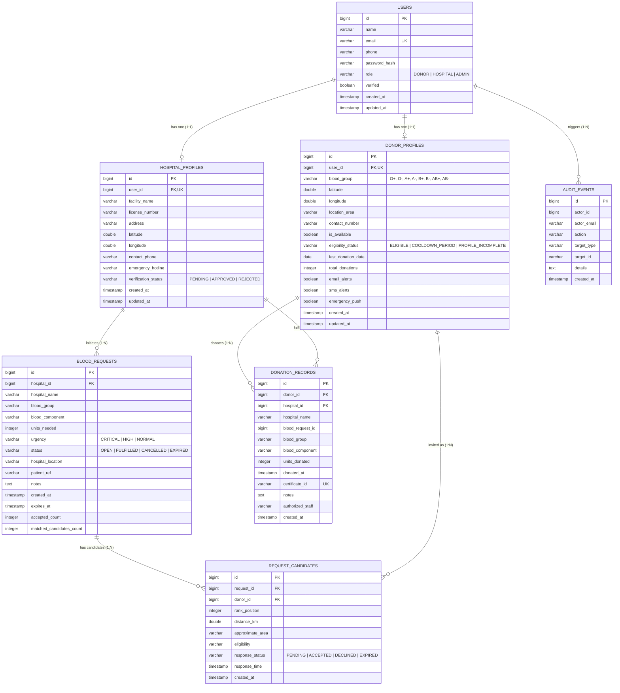

# GeoBlood Link — Backend Foundation & Database

> **Member 1: Backend Foundation and Database Architecture**  
> *GeoBlood Link: Intelligent Geo-Localized Blood Donor Discovery and Emergency Matching System*

---

## 📌 1. Overview & Assigned Responsibilities

As **Member 1 (Backend Foundation and Database)**, this module establishes the normalized persistence layer, domain model, security architecture, and REST endpoints for user authentication, voluntary donor management, hospital profile coordination, and verified donation outcome logging.

### Key Deliverables:
- **Spring Boot 3.3.5 / Java 21+** robust layered architecture (`controller`, `service`, `repository`, `entity`, `dto`, `security`, `exception`, `config`).
- **Normalized PostgreSQL relational schema** with constraints, cascade rules, and optimized indexes.
- **REST APIs matching frontend contracts**:
  - `POST /api/auth/register` & `POST /api/auth/login`
  - `GET /api/donors/me`
  - `POST /api/donors`
  - `PATCH /api/donors/me/availability`
  - `GET /api/donors/me/donations` & `GET /api/donors/me/history`
  - `GET /api/donors/me/invitations`
  - `GET /api/hospital/profile` & `POST /api/hospital/profile`
  - `POST /api/donations`
- **Stateless Spring Security with JWT tokens** & CORS configuration.
- **Server-side Jakarta validation** with standardized JSON error formatting matching `src/utils/errorHandler.js`.
- **Clean coordination entities** (`BloodRequest`, `RequestCandidate`) for Member 2's emergency matching algorithm.
- **Automated test suite (22 unit & integration tests)** using JUnit 5, Mockito, and Spring Boot MockMvc.

---

## 📊 2. Entity-Relationship (ER) Diagram



---

## 🚀 3. Quick Start & Setup Instructions

### Prerequisites
- **Java 21 LTS** (or compatible 21–25 JDK installed).
- **PostgreSQL 14+** (for production/local deployment) or run against the built-in in-memory H2 profile.
- Maven is included via the self-contained wrapper (`mvnw.cmd` / `mvnw`).

### PostgreSQL Database Setup
1. Open your terminal or `psql` console:
   ```sql
   CREATE DATABASE geoblood_db;
   ```
2. (Optional) Run the provided DDL schema and seed scripts:
   ```bash
   psql -U postgres -d geoblood_db -f backend/sql/schema.sql
   psql -U postgres -d geoblood_db -f backend/sql/data.sql
   ```
   *Note: Spring Boot will also automatically update the schema and seed synthetic accounts via `DataInitializer` if tables are empty.*

### Environment Variables
Configure your database credentials in `backend/.env` or export them:
```bash
SPRING_DATASOURCE_URL=jdbc:postgresql://localhost:5432/geoblood_db
SPRING_DATASOURCE_USERNAME=postgres
SPRING_DATASOURCE_PASSWORD=postgres
JWT_SECRET=GeoBloodLinkSecretKeyForJwtSigningMustBeAtLeast256BitsLong2026!
```

### Running the Backend
From the `backend` directory, run:
```powershell
# Windows
.\mvnw.cmd spring-boot:run

# Linux / macOS
./mvnw spring-boot:run
```
The server will start on port `8080` (`http://localhost:8080`).

---

## 🔑 4. Demo Accounts & Seed Data

The database automatically seeds standard test accounts matching the frontend demo buttons (all passwords: `password123`):

| Role | Email | Password | Pre-seeded Profile Details |
| :--- | :--- | :--- | :--- |
| **DONOR** | `donor@test.com` (or `donor@example.com`) | `password123` | O+, Available, Andheri West Mumbai, 4 past donations. |
| **DONOR** | `pooja@example.com` | `password123` | A-, Unavailable, Bandra East Mumbai, in cooldown period. |
| **HOSPITAL** | `hospital@test.com` (or `hospital@example.com`) | `password123` | City Care Hospital, License HOSP-MUM-2024-981, Verified. |
| **ADMIN** | `admin@test.com` (or `admin@example.com`) | `password123` | System Administrator. |

---

## 📖 5. REST API Documentation & Example Requests

### 1. Authentication

#### Register New User
- **Endpoint:** `POST /api/auth/register`
- **Access:** Public
- **Request Body:**
  ```json
  {
    "name": "Karan Mehra",
    "email": "karan@example.com",
    "password": "password123",
    "role": "DONOR"
  }
  ```
- **Response (201 Created):**
  ```json
  {
    "message": "Account created successfully! You can now log in.",
    "user": {
      "id": "5",
      "name": "Karan Mehra",
      "email": "karan@example.com",
      "role": "DONOR"
    }
  }
  ```

#### Login
- **Endpoint:** `POST /api/auth/login`
- **Access:** Public
- **Request Body:**
  ```json
  {
    "email": "donor@test.com",
    "password": "password123"
  }
  ```
- **Response (200 OK):**
  ```json
  {
    "token": "eyJhbGciOiJIUzI1NiIsInR5cCI6IkpXVCJ9...",
    "user": {
      "id": "1",
      "name": "Aarav Sharma",
      "email": "donor@test.com",
      "role": "DONOR"
    }
  }
  ```

---

### 2. Donor APIs

#### Get Current Authenticated Donor Profile
- **Endpoint:** `GET /api/donors/me`
- **Headers:** `Authorization: Bearer <token>`
- **Response (200 OK):**
  ```json
  {
    "id": "1",
    "userId": "1",
    "name": "Aarav Sharma",
    "bloodGroup": "O+",
    "isAvailable": true,
    "locationArea": "Andheri West, Mumbai",
    "contactNumber": "+91 98765 43210",
    "latitude": 19.1136,
    "longitude": 72.8697,
    "lastDonationDate": "2024-05-15",
    "eligibilityStatus": "ELIGIBLE",
    "totalDonations": 4,
    "notificationPrefs": {
      "emailAlerts": true,
      "smsAlerts": true,
      "emergencyPush": true
    }
  }
  ```

#### Complete / Update Donor Profile
- **Endpoint:** `POST /api/donors`
- **Headers:** `Authorization: Bearer <token>`
- **Request Body:**
  ```json
  {
    "name": "Aarav Sharma",
    "bloodGroup": "O+",
    "locationArea": "Andheri West, Mumbai",
    "contactNumber": "+91 98765 43210",
    "latitude": 19.1136,
    "longitude": 72.8697,
    "notificationPrefs": {
      "emailAlerts": true,
      "smsAlerts": true,
      "emergencyPush": true
    }
  }
  ```
- **Response (200 OK):** Updated `DonorProfileResponse` object.

#### Toggle Availability
- **Endpoint:** `PATCH /api/donors/me/availability`
- **Headers:** `Authorization: Bearer <token>`
- **Request Body:**
  ```json
  {
    "isAvailable": false
  }
  ```
- **Response (200 OK):**
  ```json
  {
    "success": true,
    "isAvailable": false,
    "message": "Donor is now marked as UNAVAILABLE."
  }
  ```

#### View Donation History
- **Endpoint:** `GET /api/donors/me/donations` (or `GET /api/donors/me/history`)
- **Headers:** `Authorization: Bearer <token>`
- **Response (200 OK):**
  ```json
  [
    {
      "id": "1",
      "requestId": "1",
      "donorId": "1",
      "hospitalName": "City Care Hospital",
      "bloodGroup": "O+",
      "bloodComponent": "Whole Blood",
      "unitsDonated": 1,
      "donatedAt": "2024-05-15T14:00:00Z",
      "certificateId": "CERT-2024-0515-O",
      "notes": "Voluntary donation fulfilled safely."
    }
  ]
  ```

---

### 3. Hospital APIs

#### Get Hospital Profile
- **Endpoint:** `GET /api/hospital/profile` (or `GET /api/hospitals/me`)
- **Headers:** `Authorization: Bearer <token>`
- **Response (200 OK):**
  ```json
  {
    "id": "1",
    "userId": "3",
    "facilityName": "City Care Hospital",
    "licenseNumber": "HOSP-MUM-2024-981",
    "address": "Central Avenue, Sector 4, Mumbai",
    "latitude": 19.0760,
    "longitude": 72.8777,
    "contactPhone": "+91 22 2847 0000",
    "emergencyHotline": "+91 98200 11223",
    "verificationStatus": "APPROVED"
  }
  ```

#### Create / Update Hospital Profile
- **Endpoint:** `POST /api/hospital/profile` (or `PUT /api/hospital/profile`)
- **Headers:** `Authorization: Bearer <token>`
- **Request Body:**
  ```json
  {
    "facilityName": "City Care Hospital",
    "licenseNumber": "HOSP-MUM-2024-981",
    "address": "Central Avenue, Sector 4, Mumbai",
    "latitude": 19.0760,
    "longitude": 72.8777,
    "contactPhone": "+91 22 2847 0000",
    "emergencyHotline": "+91 98200 11223"
  }
  ```
- **Response (200 OK):** Updated `HospitalProfileResponse` object.

---

### 4. Donations Outcome Recording

#### Record Final Donation Outcome
- **Endpoint:** `POST /api/donations`
- **Headers:** `Authorization: Bearer <token>` (Hospital or Admin role)
- **Request Body:**
  ```json
  {
    "requestId": 1,
    "donorId": 1,
    "unitsDonated": 1,
    "donatedAt": "2026-10-15T10:00:00Z",
    "notes": "Voluntary donation fulfilled safely."
  }
  ```
- **Response (201 Created):**
  ```json
  {
    "message": "Donation outcome recorded successfully.",
    "donation": {
      "id": "3",
      "requestId": "1",
      "donorId": "1",
      "hospitalName": "City Care Hospital",
      "bloodGroup": "O+",
      "bloodComponent": "Whole Blood",
      "unitsDonated": 1,
      "donatedAt": "2026-10-15T10:00:00Z",
      "certificateId": "CERT-829104-OP",
      "notes": "Voluntary donation fulfilled safely."
    }
  }
  ```

---

### 5. Standardized Error Handling

All controller errors conform strictly to the format required by `src/utils/errorHandler.js`:

```json
{
  "status": 400,
  "message": "Validation failed. Please correct the fields.",
  "errors": {
    "bloodGroup": "Blood group is required",
    "contactNumber": "Please provide a valid phone number (8-16 digits)"
  }
}
```

---

## 🤝 6. Coordination With Teammates

### Member 2 (Matching Algorithm, Haversine Ranking, Concurrency)
- **Entities Provided:**
  - `BloodRequest`: Represents emergency hospital requests (`bloodGroup`, `unitsNeeded`, `urgency`, `status`, `expiresAt`, `acceptedCount`, `matchedCandidatesCount`).
  - `RequestCandidate`: Tracks candidates ranked by distance (`rankPosition`, `distanceKm`, `approximateArea`, `responseStatus`, `responseTime`).
- **Repositories Provided:** `BloodRequestRepository`, `RequestCandidateRepository`.
- **Enums Shared:** `BloodGroup`, `Urgency`, `RequestStatus`, `CandidateResponseStatus`.
- **Integration Boundary:** Member 2 can plug their spatial queries or in-memory Haversine distance calculator directly into `BloodRequest` and `RequestCandidate` without altering database schema or User/Donor profiles.

### Member 3 (Frontend & Client-Side Architecture)
- **CORS Configured:** Allows `http://localhost:5173` and `http://localhost:3000` with credential support.
- **Base URL:** Frontend `.env` switches seamlessly:
  ```env
  VITE_USE_MOCK=false
  VITE_API_BASE_URL=http://localhost:8080/api
  ```
- **Token Format:** Central Axios interceptor receives standard JWT token in `token` property and `user` payload during login.

---

## 🧪 7. Automated Testing Results

The automated test suite runs via JUnit 5 and Spring Boot Test with an in-memory H2 database:

```powershell
.\mvnw.cmd test
```

### Actual Test Execution Output:
```
[INFO] Running com.geoblood.controller.AuthControllerTest
[INFO] Tests run: 5, Failures: 0, Errors: 0, Skipped: 0
[INFO] Running com.geoblood.controller.DonationControllerTest
[INFO] Tests run: 2, Failures: 0, Errors: 0, Skipped: 0
[INFO] Running com.geoblood.controller.DonorControllerTest
[INFO] Tests run: 6, Failures: 0, Errors: 0, Skipped: 0
[INFO] Running com.geoblood.controller.HospitalControllerTest
[INFO] Tests run: 3, Failures: 0, Errors: 0, Skipped: 0
[INFO] Running com.geoblood.controller.SecurityAndErrorHandlingTest
[INFO] Tests run: 2, Failures: 0, Errors: 0, Skipped: 0
[INFO] Running com.geoblood.repository.RepositoryTests
[INFO] Tests run: 4, Failures: 0, Errors: 0, Skipped: 0
[INFO] 
[INFO] Results:
[INFO] Tests run: 22, Failures: 0, Errors: 0, Skipped: 0
[INFO] BUILD SUCCESS
```
